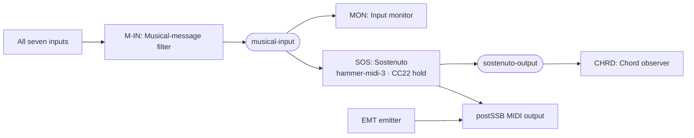
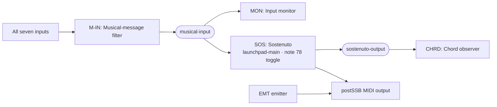

# Sostenuto

Sostenuto is an external module, discovered through the standard module service API.
The root Maven build produces `extensions/sostenuto/target/sostenuto.jar` and installs
a development copy at `modules/sostenuto.jar`. The Windows distribution includes it
in `MidiRat/modules/sostenuto.jar`. Keep this JAR in the configured `moduleDirectory`;
the host JAR does not contain the sostenuto implementation. Existing YAML settings
and network wiring are unchanged. Replacing or removing this JAR uses the normal
module watcher and does not send automatic cleanup MIDI.

Run `mvn package` from the repository root to rebuild the host and module without
Windows packaging; `mvn verify` also runs integration checks and Windows packaging.
VS Code's sostenuto launch configurations build the module before starting the host.

The `sostenuto` processor emulates piano sustain/sostenuto ownership before an
instrument receives MIDI. Sustain holds released notes; sostenuto captures notes
pressed or already sustained when it engages. Held notes can pass between pedals
without an intermediate release. CC64 and CC66 are consumed by the emulation.
Other MIDI passes unchanged, except messages from explicitly dedicated control inputs.

```yaml
- name: SOS
  type: sostenuto
  sources: [keys, pedals, performance]
  destinations: [processed]
  settings:
    controlSources: [pedals]
    trigger: {cc: 22, toggle: false, invert: false}
    activationThreshold: 10
    hysteresis: 2
    umbrella: {enabled: false, delayMs: 1, tailMs: 1}
```

All settings are optional. Without a control selector, the trigger may come from any
subscribed input. `controlSources` selects immediate subscriptions. When specified,
these sources are dedicated controls: only their
configured trigger is accepted; their other MIDI is consumed. Primary sources
continue to support native CC66. Origin and source identity do not split pedal/note
ownership after this selection; state is per MIDI channel and pitch.

Use `controlOrigins: [launchpad-main]` instead when inputs have merged through a
filter or bus. It selects original logical input aliases from `Envelope.origin()`;
the immediate source can then be a shared bus. Select either `controlSources` or
`controlOrigins`, never both. Origin lists must be nonempty and unique; unknown
origin aliases are rejected at module startup before routing activates.

Use `trigger: {note: 78, toggle: true}` for a note-button toggle. Use either `cc` or
`note`, never both. The default is CC22. Toggle changes once per press, with release
re-arming the next press. Momentary note triggers accept any positive velocity and
release on note-off or velocity-zero note-on. CC triggers optionally invert incoming
values before applying thresholds. Inversion is not valid for note triggers.
Sustain uses threshold 64; sostenuto and CC trigger edges use activation 10 and
release 8 by default. These thresholds have per-channel hysteresis.

Umbrella mode protects retained/latched retriggers with a temporary outgoing CC64
pulse: pedal-down, delayed note-on, then pedal-up after the configured tail. Overlaps
share one pulse per channel. Timing values are 0..60000 ms and depend on OS scheduling.
Up to 4096 delayed actions are allowed; saturation reports a diagnostic and passes
new retriggers without new protection. A release arriving before a delayed note-on
cancels that retrigger, preventing it from sounding after its release.

The module has bounded pressed, latched, and deferred-release state, with boolean
key ownership per channel/pitch rather than overlapping-note pairing. It shows pedal
and key counts in its widget. Pedal release emits deferred note-offs at velocity zero;
ordinary note-off payloads pass unchanged when not retained. Use existing filter/remap
modules before or after this processor for channel selection or channel remapping.

Incoming CC120/CC123 clears only its channel and is forwarded; CC121 releases its
deferred unpressed notes and resets pedals while preserving physically pressed keys.
These explicit resets cancel that channel's delayed retriggers and end an active
umbrella pulse. They do not trigger a global panic. Host Panic reaches internal buses,
so include a bus among this module's sources (the demos use `musical-input`).
Reload, removal, and shutdown discard state and cancel delayed work without emitting
cleanup MIDI. Input origin and receipt timestamps are preserved for delayed results.

## Run the demo

[network-sostenuto.yaml](../config/network-sostenuto.yaml) combines musical MIDI from
all seven configured inputs, using CC22 from `hammer-midi-3` as the dedicated
momentary pedal control.
The second example, [network-sostenuto-launchpad.yaml](../config/network-sostenuto-launchpad.yaml),
uses `launchpad-main` (`LPProMK3 MIDI`) as its dedicated control origin. Note 78
toggles sostenuto once per press; release re-arms the next
press and the control note is consumed.

Both examples route all seven input aliases through one musical-message filter into
`musical-input`. It accepts note-on/off, CC, pitch bend, channel/polyphonic pressure,
and program changes. CLOCK, SysEx, transport, and other system messages are excluded.
`postSSA` and `postSSB` remain excluded from inputs to avoid loopback feedback.

The input monitor and sostenuto both subscribe to `musical-input`: the monitor shows
filtered input before pedal processing, including the control trigger. The chord
observer reads only `sostenuto-output`, after retention and trigger consumption.
The processor also sends its output to physical `postSSB`. Umbrella remains enabled
with a 1 ms delay and 1 ms tail. Both backend application variants bind alias `virt-out` to `postSSB`;
Windows MIDI Services uses its discovered stable endpoint/group ID.

The instance names are `M-IN` (musical-message filter), `MON` (input monitor),
`SOS` (sostenuto), `CHRD` (chord observer), and `EMT` (manual emitter).

Both networks also include `EMT`, an initially empty hex emitter connected
directly to `virt-out` (physical port `postSSB`). Focus it with Tab, use `e` to edit or `v` to paste a copied
message, and press Enter to send the sequence. Its direct output is separate from
the MON and chord-observer subscriptions. These networks are shared by
their WinMM and Windows MIDI Services application variants.

### CC22 momentary-control network



### Launchpad note-78 toggle network



### Terminal commands

From the repository root, with the rebuilt Windows image:

```powershell
.\target\jpackage-out\MidiRat\MidiRat.exe --config .\config\wms-application-sostenuto.yaml
```

Use `wmm-application-sostenuto.yaml` for WinMM instead. VS Code includes
`MIDI Rat: sostenuto (Windows MIDI Services)` and `MIDI Rat: sostenuto (WinMM)` launch
configurations. The original monitor configurations remain unchanged.

For the Launchpad note-78 example with Windows MIDI Services:

```powershell
.\target\jpackage-out\MidiRat\MidiRat.exe --config .\config\wms-application-sostenuto-launchpad.yaml
```

Use `wmm-application-sostenuto-launchpad.yaml` for WinMM. VS Code includes matching
`sostenuto Launchpad note 78` launch configurations for both backends.
